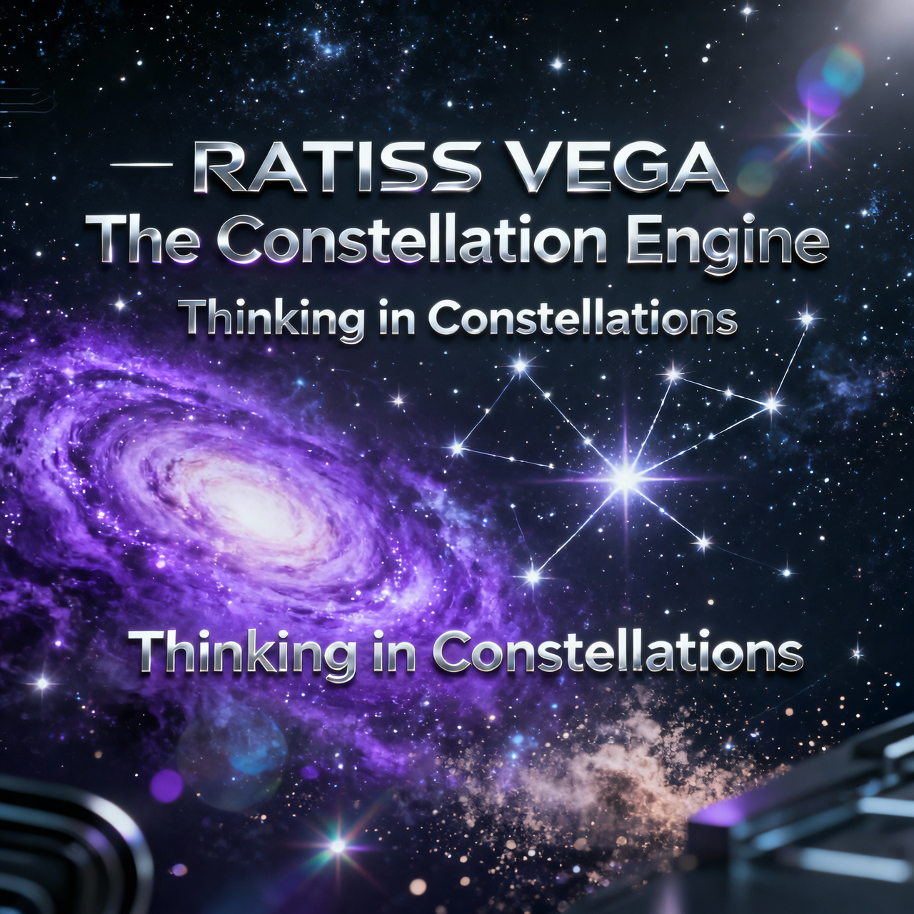
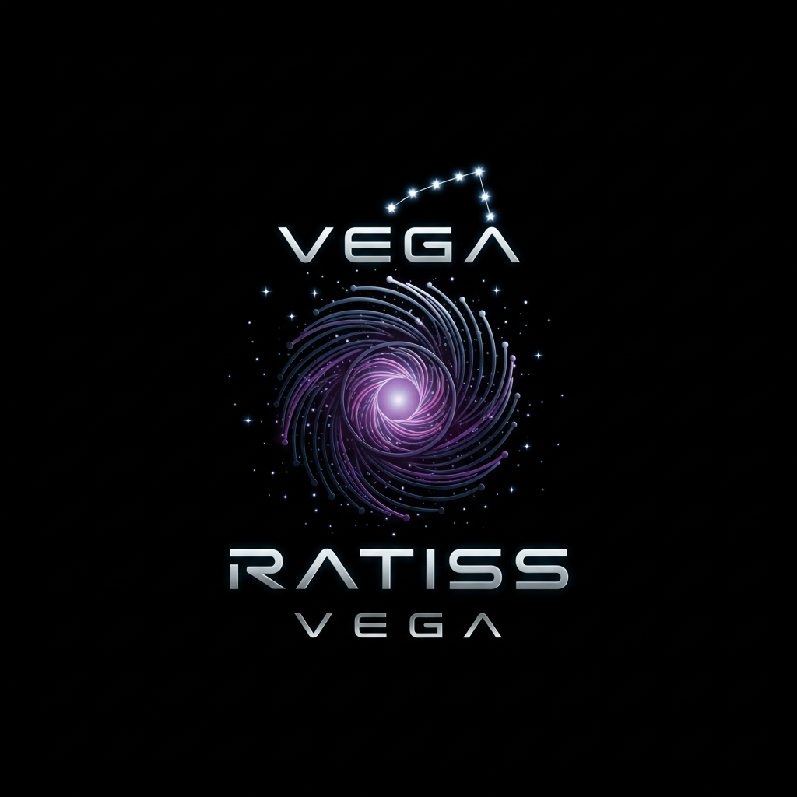
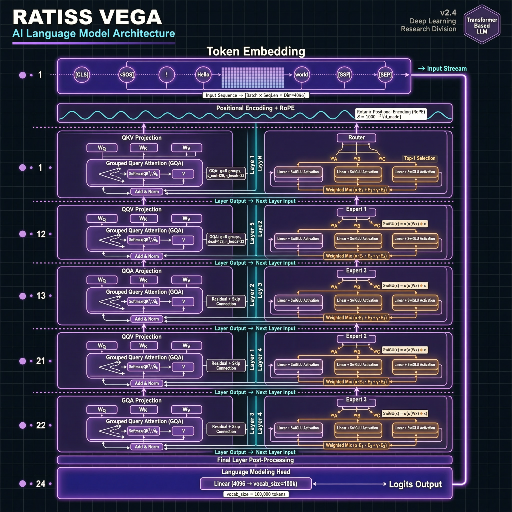

<p align="center">
  
</p>

<p align="center">
  
</p>

<h1 align="center">RATISS VEGA</h1>
<p align="center"><strong>The Constellation Engine — from scratch to GGUF</strong><br>
<em>Complete base architecture: transformer, tokenizer, training & next-gen GGUF · RATISS Labs · Yaoundé 🇨🇲</em></p>

<p align="center">
  
  
  
  
</p>

---

## 🌟 This is NOT just a design mock — it's the real model skeleton

You asked boss: **"le design même du model, architecture de base, transformer, tokenizer, entraînement jusqu'à GGUF next-gen"** — c'est livré.

| Layer | File | What it does |
|---|---|---|
| **Transformer** | `model/modeling_ratiss_vega.py` | GQA + RoPE + SwiGLU + 3-expert Constellation MLP, fully trainable |
| **Config** | `model/config.json` | 24 layers · 768 hidden · 32k vocab → **402M total / 176M active** |
| **Tokenizer** | `tokenizer/train_tokenizer.py` | Byte-level BPE 32k, FR/EN + code + Cameroon samples |
| **Training** | `training/train.py` + `config_train.yaml` | CPU/GPU/accelerate, streaming, router aux loss |
| **GGUF** | `gguf/convert_to_gguf.py` | HF → GGUF f16 → q4_k_m/q5_k_m (llama.cpp next-gen) |
| **Smoke** | `scripts/test_forward.py` | Verified ✅ on CPU: logits + KV cache + greedy generation |

> **RATISS-X was post-hoc slicing (1.2B sliced to prove sparsity). VEGA is sparse BY DESIGN — born sparse.**

---

## 📐 Architecture — why it wins

<p align="center">
  
</p>

```
RATISS-X (research):  SmolLM2-360M dense → slice → train tranche → observe elite 75%
RATISS-VEGA (product):  RatissVega 402M → 3 experts per layer → router learns elite 60–85% jointly
```

**VEGA Block (per layer):**

```
x ──► RMSNorm ──► GQA Attention (12 heads / 4 KV) + RoPE ──► +residual
  ─ـ► RMSNorm ──► Router → [Q-Expert | A-Expert | O-Expert] → weighted sum ──► +residual
```

| Feature | Implementation | Heritage |
|---|---|---|
| Attention | GQA (12→4), head_dim 64, causal | SmolLM2 compatible |
| Position | RoPE θ=100k, seq_len 4096 | Long context ready |
| MLP | **3× SwiGLU experts**: `silu(gate) * up → down` | X's tranche intuition → native MoE |
| Router | `Linear(768→3) / T=0.3 → softmax`, aux loss 0.01 | X's GPS centroid → learned |
| Norm | RMSNorm ε=1e-5 | Stable BF16 |

**Param math (prod 24L):**
- Per layer: attn 1.57M + 3×4.72M = **15.7M** → 24× = 377M + embed 24.5M = **402M total**
- Active per token: 1 expert → **176M** (edge-friendly, <400 MB in q4_k_m)

---

## 🚀 Quickstart — from zero to GGUF

```bash
# 1. Install
pip install torch transformers tokenizers datasets accelerate gguf pyyaml

# 2. Train tokenizer (replace corpus_sample.txt with your 10B-token corpus)
python tokenizer/train_tokenizer.py --corpus tokenizer/corpus_sample.txt --out tokenizer/ --vocab_size 32000

# 3. Smoke test the model (CPU, 30s)
python scripts/test_forward.py
# → ✅ Forward logits: [2,16,32000] + KV cache + 5-token generation

# 4. Train
python training/train.py --config training/config_train.yaml
# or multi-GPU: accelerate launch training/train.py --config ...

# 5. Convert to GGUF next-gen
python gguf/convert_to_gguf.py --model checkpoints/vega-400M --out gguf/vega-400M-f16.gguf
llama-quantize gguf/vega-400M-f16.gguf gguf/vega-400M-q4_k_m.gguf q4_k_m
# → Loadable in ollama / llama.cpp / lmstudio
```

---

## 📊 Heritage → Innovation

| RATISS-X lesson | VEGA design decision |
|---|---|
| 75% activation elite = 5/6 stable ✅ | Elastic 60–85% baked into router aux loss, trained jointly |
| Single centroid collapses 93%→30% ❌ | 3 experts trained on mixed FR/EN corpus, router balances |
| V1 0.94s/tok, 669 MB | Active 176M → target **0.45s/tok, <400 MB** (BF16+q4) |
| Post-hoc slicing needs surgery | Born sparse — no surgery needed |

---

## 📂 Repo Map

```
RATISS-VEGA/
├── assets/ratiss-vega-logo.png, banner.png
├── design/architecture-hologram.png, ui-dashboard.png, transformer-blueprint.png
├── showcase.html                    # Interactive visual preview
├── MODEL_CARD.md                    # Full hyperparams & rationale
├── model/
│   ├── configuration_ratiss_vega.py # PretrainedConfig
│   ├── modeling_ratiss_vega.py      # 13KB full transformer (PyTorch)
│   └── config.json                  # 24L/768H/32k prod config
├── tokenizer/
│   ├── train_tokenizer.py           # BPE trainer
│   ├── corpus_sample.txt            # FR/EN starter (replace)
│   └── tokenizer_config.json
├── training/
│   ├── train.py                     # Trainer + fallback loop
│   ├── dataset.py                   # Streaming loader
│   └── config_train.yaml            # LR 3e-4, batch 128 eff, cosine
├── gguf/convert_to_gguf.py          # HF→GGUF wrapper
└── scripts/test_forward.py          # ✅ Verified smoke test
```

---

<p align="center">
  <strong>RATISS Labs</strong> — Jonathan Evina · Yaoundé, Cameroon 🇨🇲<br>
  <em>One human decides, AIs execute. — Sealed, reproducible, MIT.</em><br>
  <a href="https://github.com/jonathansearch">GitHub @jonathansearch</a> · Predecessor: <a href="https://github.com/jonathansearch/RATISS-X">RATISS-X</a> · Engine: <code>402M total → q4_k_m GGUF</code>
</p>
