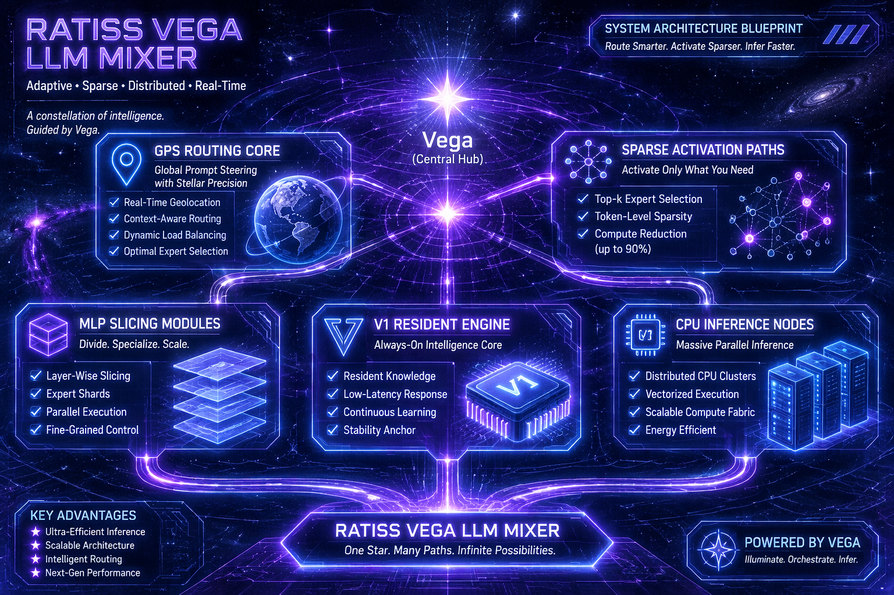
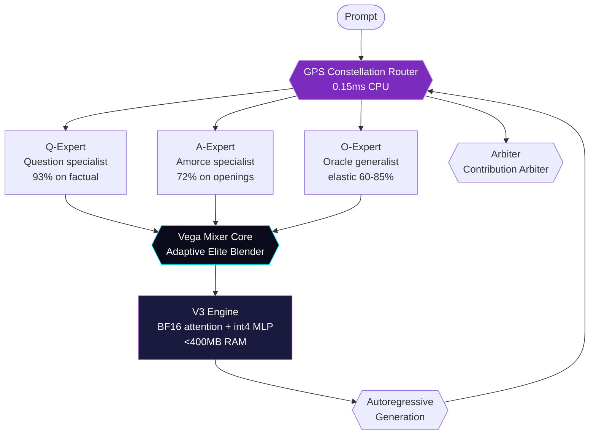

# RATISS VEGA — Constellation Architecture

> **Design spec v0.1 — Not implemented, only designed.**

<p align="center">
  
</p>

## 1. Vision

Upgrade RATISS-X's **single-path mixer** into a **constellation mixer**:

- RATISS-X routed each token through *one* elite path (oracle, 75% magnitude/activation).
- VEGA routes each token through a **constellation**: 3–5 coordinated experts whose weighted mixture *is* the thought.

## 2. System Overview



## 3. Components

### 3.1 GPS Constellation Router

| Sub-router | Training source | Centroid | Role |
|---|---|---|---|
| **Q** | 60 factual questions | question-only centroid | factual recall |
| **A** | 36 frozen prompts | amorce-only centroid | opening coherence |
| **O** | contributions logs | activation-elite centroid | general fallback |

**Arbiter logic:**

```python
scores = [cos(prompt_vec, c) for c in (Q, A, O)]
weights = softmax(scores / temperature)  # T=0.3
if max(weights) < 0.45:
    weights = [0.35, 0.35, 0.30]  # consensus mode
```

Target latency: **0.15 ms** on 2-core CPU (NumPy, no Torch).

### 3.2 Adaptive Elite Threshold

RATISS-X used fixed 75% top-K. VEGA = **elastic**:

```python
def elite_threshold(layer_idx, token_entropy):
    base = 0.75
    depth_factor = 1 + 0.1 * (layer_idx / 32)  # deeper = keep more
    entropy_factor = 1 - 0.15 * (1 - token_entropy)  # uncertain = keep more
    return clamp(base * depth_factor * entropy_factor, 0.60, 0.85)
```

Logged in `contribution_trace.jsonl` per token for reproducibility.

### 3.3 Vega Mixer Core

```
hidden ──┬─► Q-MLP (elastic elite) ─┐
         ├─► A-MLP (elastic elite) ─┼─► weighted sum (arbiter weights) ─► residual
         └─► O-MLP (elastic elite) ─┘
```

Each MLP = physically sliced tranches (heritage from RATISS-X D1–D4), but now **quantized adaptively**:

- Elite neurons (active): **BF16 resident** (fast path)
- Inactive 40%: **int4 per-row** (memory saver, rarely touched)

### 3.4 V3 Engine — Memory Budget

| Component | RATISS-X V1 | VEGA V3 target |
|---|---|---|
| Attention (shared, resident) | 380 MB | **190 MB** (BF16, shared) |
| MLP elite (active) | 270 MB | **140 MB** |
| MLP inactive (int4) | — | **45 MB** (vs 280 MB BF16) |
| Router + overhead | 19 MB | **20 MB** |
| **Total RSS** | 669 MB | **~395 MB** |

Fits in 512 MB edge devices. Target speed **0.45–0.60 s/token** on 2-core (vs V1 0.94s).

## 4. Data Flow Example

**Prompt:** *"The capital of France is"*

1. Embed → 960-dim vector
2. GPS constellation: Q=0.81, A=0.34, O=0.55 → weights [0.52, 0.12, 0.36]
3. Layer 8: elite=68% (low entropy, shallow)
4. Layer 24: elite=82% (deeper, needs nuance)
5. Mixer blends Q+A+O MLPs per layer
6. Logits → " Paris" (cos 0.93 vs dense)

## 5. Non-goals (v0)

- No GPU path (CPU-only lab principle)
- No training in v0 (inference-only design)
- No external API calls (fully offline)
