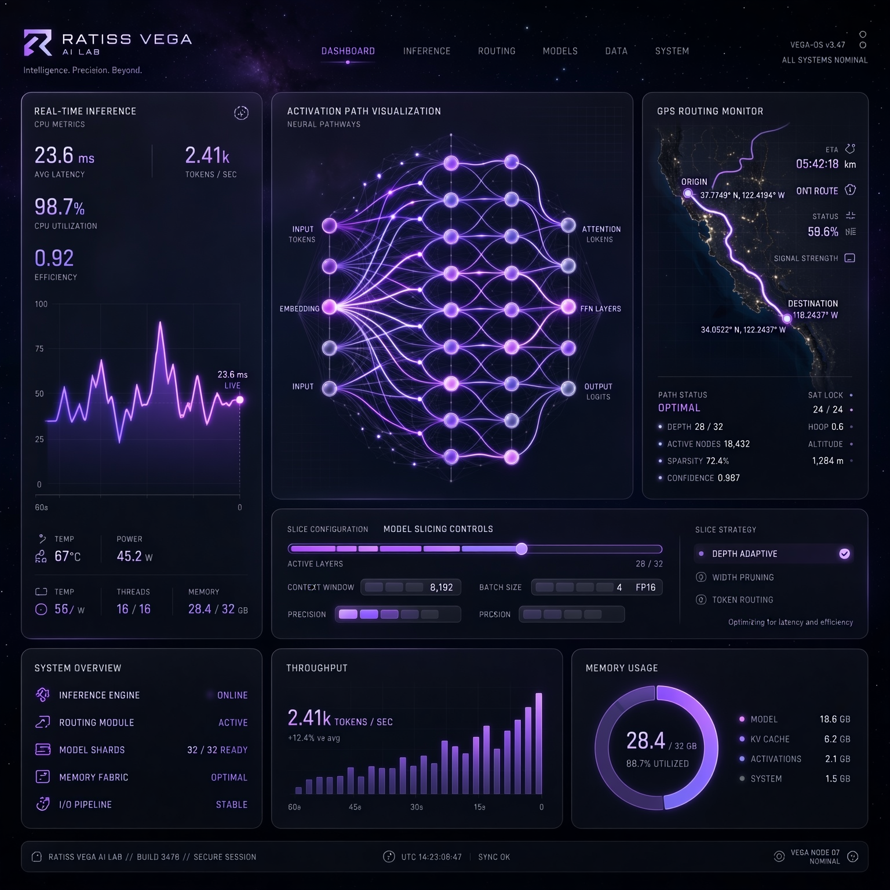

# RATISS VEGA — UI/UX Design System

<p align="center">
  
</p>

## Design Language: **Stellar Glassmorphism**

Inspired by satellite mission control + modern AI labs (Linear, Vercel).

### Colors

| Name | Hex | Usage |
|---|---|---|
| Deep Space | `#0A0A1A` | Background |
| Panel Glass | `rgba(18,18,42,0.8)` backdrop-blur | Cards |
| Vega Purple | `#7B2CBF` | Primary CTA, active paths |
| Nebula Violet | `#B185DB` | Hover, secondary |
| Star White | `#F8F9FA` | Text |
| Signal Cyan | `#00F5FF` | Routing lines, telemetry |
| Alert Amber | `#FFB703` | Warnings |

### Typography

- **Display:** Space Grotesk Bold (headers, Vega title)
- **Body:** Inter Regular (metrics, docs)
- **Mono:** JetBrains Mono (logs, JSON, tokens)

### Dashboard Layout

```
┌─────────────────────────────────────────────────────┐
│  ☰ RATISS VEGA    Constellation Engine  ● LIVE  [◐] │
├──────────────┬──────────────────┬───────────────────┤
│  GPS Monitor │  Mixer Core      │  V3 Telemetry     │
│  Q █████ 52% │  Layer 12/32     │  0.52 s/tok       │
│  A ██    12% │  Elite 74%       │  395 MB RSS       │
│  O ████  36% │  ╱╲ paths active │  6.2 tok/s        │
│              │  contrib heatmap │  Temp 42°C        │
├──────────────┴──────────────────┴───────────────────┤
│  Generation Stream: "The capital of France is Paris." │
│  [ Paris ] viewed • routing trace • copy JSON       │
├─────────────────────────────────────────────────────┤
│  Constellation Map  (interactive SVG)                │
│   • Vega star center, 3 expert orbits               │
└─────────────────────────────────────────────────────┘
```

### Key Interactions

1. **Routing Trace** — Hover any token → see Q/A/O weights + layer-wise elite%
2. **Constellation Map** — Drag experts → arbiter recomputes live (demo mode)
3. **Memory Dial** — Real-time int4 vs BF16 split (donut chart)
4. **Sealed Logs** — Every generation writes SHA-256 sealed JSONL (lab tradition)

### Component Library

- `VegaButton` — violet gradient, star sparkle on hover
- `GlassPanel` — blur 12px, border 1px rgba(255,255,255,0.08)
- `PathLine` — animated cyan dotted line for activation paths
- `MetricCard` — large mono number + sparkline
- `Terminal` — mono logs with `> vega --prompt "Hello"` prompt

See `showcase.html` for live coded prototype.
